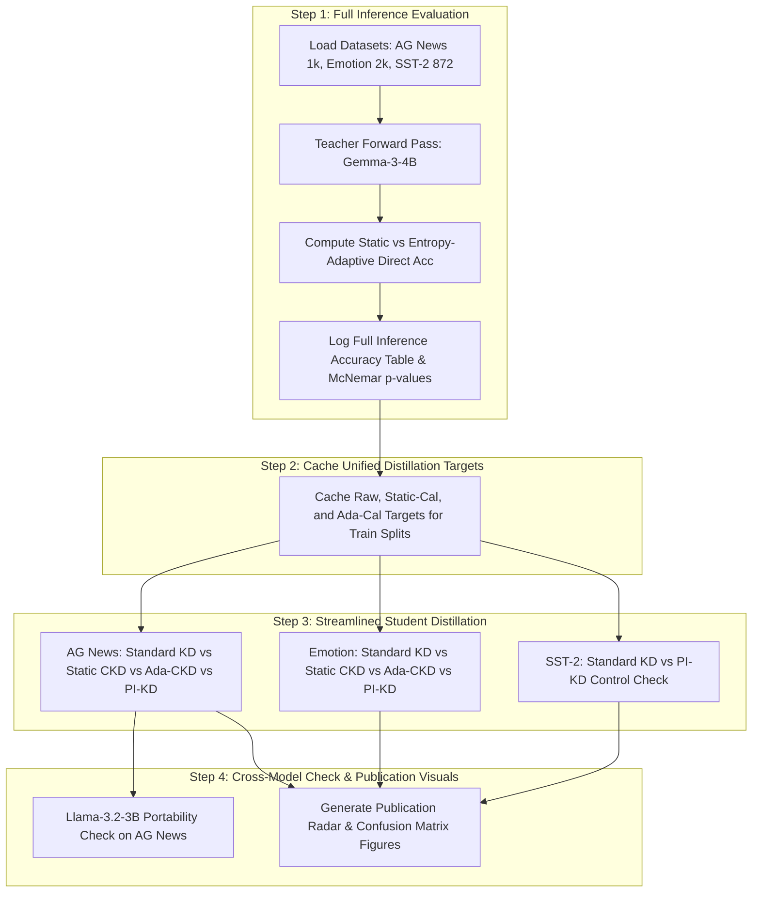

# Master Execution Plan: Prior-Invariant Knowledge Distillation (PI-KD)

---

## 1. Selected Dataset Triad (Canonical, High-Agreement, Zero Subjectivity)

To eliminate any critique regarding label quality or subjective annotations, we finalize three canonical benchmarks:

| Role | Benchmark | Classes | Evaluation Split ($N$) | Expected Prior Skew |
| :--- | :--- | :---: | :--- | :--- |
| **Primary Testbed 1** | **AG News** | 4 | $N = 1,000$ (Full 4-way balanced) | **Severe** ($\Delta = 15.12$ L, $3.6\text{M}\times$ skew) |
| **Primary Testbed 2** | **Emotion** | 6 | $N = 2,000$ (Full canonical test) | **Severe** ($\Delta = 7.31$ L, $1,499\times$ skew) |
| **Control / Sanity** | **SST-2** | 2 | $N = 872$ (Full canonical validation) | **Minimal** ($\Delta = 1.25$ L, $1.1\times$ skew) |

*(Boundary condition reference: NLI retained for the semantic null prompt discussion).*

---

## 2. Models Matrix (Fixed to Avoid Combinatorial Explosion)

* **Primary Teacher:** `google/gemma-3-4b-it` (BF16, 4B)
* **Primary Student:** `Qwen/Qwen3-4B` (LoRA, BF16, 4B)
* **Generality Check (Student):** `unsloth/Llama-3.2-3B-Instruct` (LoRA, BF16, 3B) — *single run on AG News to prove cross-model portability*.

---

## 3. The 4 Algorithmic Variants (From Baseline to Full Framework)

We compare four distinct configurations to quantify the contribution of each algorithmic piece:

```
┌────────────────────────────────────────────────────────────────────────┐
│                        ALGORITHMIC VARIANTS MATRIX                     │
├─────────────────────┬───────────────────────────┬──────────────────────┤
│ Variant             │ Formula / Target          │ Mechanism            │
├─────────────────────┼───────────────────────────┼──────────────────────┤
│ 1. Standard KD      │ p = σ(z_T / T)            │ Standard Hinton KD   │
├─────────────────────┼───────────────────────────┼──────────────────────┤
│ 2. Static CKD       │ p = σ((z_T - W_null) / T) │ Rigid subtraction    │
├─────────────────────┼───────────────────────────┼──────────────────────┤
│ 3. Entropy-Adaptive │ p = σ((z_T - α(x)·W)/T)   │ Uncertainty-gated;   │
│    (Ada-CKD)        │ α(x) = H(p) / log K       │ prevents over-shift  │
├─────────────────────┼───────────────────────────┼──────────────────────┤
│ 4. Prior-Invariant  │ L_Ada-CKD + λ · R_null(S) │ Full framework:      │
│    KD (PI-KD)       │ R_null = KL(S(x_null) ‖ U)│ Adaptive + Loss reg  │
└─────────────────────┴───────────────────────────┴──────────────────────┘
```

---

## 4. Execution Workflow (Step-by-Step)



---

## 5. What Each Test Defends in the Paper

1. **Full Inference Comparison ($N \ge 1,000$):** Refutes the *"sample size too small"* and *"random noise"* critiques with $p < 0.001$.
2. **Ada-CKD vs Static CKD:** Proves that entropy-gated calibration eliminates the rigid subtraction flaw and prevents over-correction.
3. **PI-KD (Loss Regularization):** Elevates the work from an ad-hoc target-preprocessing trick to a principled, loss-level distillation objective.
4. **Llama-3.2-3B Check:** Proves the method is not a Qwen-specific or Gemma-specific artifact.
